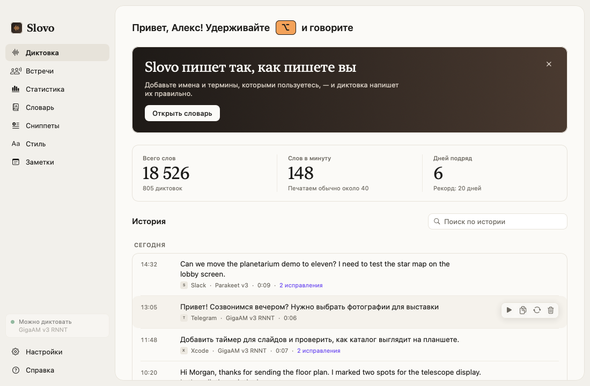
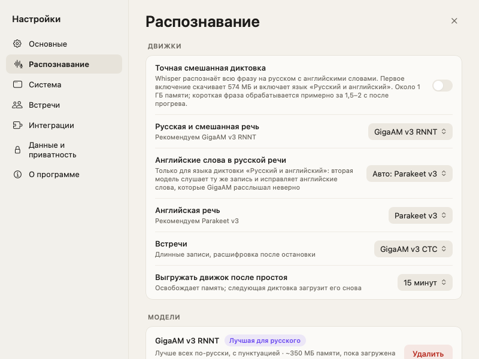

# Slovo

**Push-to-talk dictation in Russian and English on your Mac.** Speech recognition runs locally without cloud processing. On an Apple Silicon Mac with macOS 14.4 or later, download the DMG from [GitHub Releases](https://github.com/evgeniyov/Slovo/releases) and drag Slovo to Applications. Follow setup to grant permissions and download a speech model. Hold Fn while you speak. Release it to paste the text at the cursor.

## What Slovo does

Hold the dictation key and speak in Russian or English. When you release the key, the text appears in the active field. Slovo also records meetings and calls, labels speakers in the transcript, and exports it as Markdown.

### Screenshots

| Home | Dictionary |
|---|---|
|  |  |

| Meetings | Recognition settings |
|---|---|
|  |  |


## Download and setup

Get the installers and checksums from [GitHub Releases](https://github.com/evgeniyov/Slovo/releases).

- **macOS.** Requires Apple Silicon and macOS 14.4 or later. Open `Slovo-<version>-macos-arm64.dmg` and drag Slovo to Applications. The build uses an ad hoc signature and has no Apple notarization. If macOS blocks the first launch, look for Open Anyway under Privacy & Security in System Settings. [Apple instructions](https://support.apple.com/en-us/102445).
- **Windows.** Requires x64 and Windows 10 2004 or later, or Windows 11. Run `Slovo-<version>-win-x64-setup.exe` to install Slovo for the current user. For the portable version, extract the entire `Slovo-<version>-win-x64-portable.zip` archive and run `Start Slovo.cmd`. The portable version stores its data in the `Data` folder next to the app.

On first launch on the Mac, set the dictation key, download a model, and grant permissions. Slovo needs Microphone access to record, Input Monitoring for the global shortcut, and Accessibility access to paste. If it cannot paste the text, it copies it to the clipboard. Fn (Globe) is the default key. If macOS also reacts to Fn, turn off that action in Keyboard settings or choose a different key in Slovo. macOS asks for separate permissions to record the screen and other participants' audio.

## macOS features

- **Push-to-talk and hands-free dictation.** The panel shows when Slovo listens, recognizes speech, or copies text.
- **Russian, English, and mixed speech.** You can choose engines for dictation and meetings. For Russian speech with English terms, use the fast mode with a helper or the accurate mode with Whisper.
- **Dictionary, snippets, and cleanup.** Slovo suggests a replacement when the same misrecognized term appears repeatedly in your history. The dictionary can correct "кибернетес" to Kubernetes. A snippet expands a short phrase into saved text. Cleanup removes filler words and repetitions.
- **History and notes.** Search past dictation, play recordings, or transcribe them with another engine. You can also dictate directly into a note.
- **Meetings.** Slovo records the microphone and system audio, with optional screen recording. Transcripts include timestamps, speaker labels, and important moments. Speaker separation requires macOS 15 or later.
- **Inbox.** Import audio from the Inbox folder or recordings from Android and transcribe them as meetings.
- **Claude integration.** Claude can read meetings through local MCP. With separate permission, it can add summaries, decisions, and tasks.
- The interface is available in Russian and English.

## How it works

While you record, GigaAM starts recognizing completed chunks of up to 20 seconds. When you release the key, the engine finishes processing. Slovo applies dictionary replacements, snippets, and formatting rules before pasting the text.

In fast Russian-English mode, Slovo sends the recording to a helper if GigaAM returns words that look like misrecognized English. Auto mode chooses a downloaded model, either Whisper large-v3 turbo or Parakeet v3. Slovo takes only the matching English words from the helper response. It waits up to `max(3 s, recording length / 2)`: the greater of 3 seconds or half the recording length. If the helper fails or times out, Slovo uses the GigaAM text. In accurate mixed-language mode, Whisper transcribes the whole utterance with a prompt made from dictionary terms.

For meetings, Slovo saves microphone and system audio on separate tracks. After recording, the model separates the speech by speaker and the selected engine transcribes the speech. You can view the result in the meeting details and export it as Markdown.

### Models

| Model | Use | License |
|---|---|---|
| [GigaAM v3 RNNT and CTC](https://github.com/salute-developers/GigaAM) (Sber) | Russian and mixed speech via sherpa-onnx and ONNX Runtime | MIT |
| [Parakeet TDT 0.6B v3](https://huggingface.co/nvidia/parakeet-tdt-0.6b-v3) (NVIDIA) | English speech and mixed-language helper, via FluidAudio and Core ML on Mac | CC BY 4.0 |
| [Whisper large-v3 turbo](https://github.com/openai/whisper) (OpenAI) | Accurate mixed dictation and mixed-language helper via [whisper.cpp](https://github.com/ggml-org/whisper.cpp) and Metal | MIT |
| [pyannote community-1](https://huggingface.co/pyannote/speaker-diarization-community-1) (pyannoteAI) | Speaker separation with FluidInference's Core ML version | CC BY 4.0 |
| Apple Dictation | System engine in macOS 26 or later | Apple terms |

## Privacy

Speech recognition runs on your device. Slovo has no account or telemetry. You need an internet connection to download models. On Mac, Slovo stores recordings, history, and meetings in `~/Library/Application Support/Slovo/`. On Windows, the installed app uses `%LOCALAPPDATA%\Slovo`.

MCP access to meetings is off by default. If you turn it on, the Claude client starts Slovo locally and can read the data you allow. Permission to write meeting notes is separate.

## Build from source

### macOS

You need an Apple Silicon Mac, Python 3, and Xcode 26. GitHub Actions uses Xcode 26.3. The built app runs on macOS 14.4 or later.

```bash
git clone https://github.com/evgeniyov/Slovo.git
cd Slovo
xcodebuild -version
swift package resolve
python3 Scripts/repair_onnxruntime_framework.py
python3 build.py --dmg --sign-identity -
open Slovo.app
```

Check that `xcodebuild -version` shows the selected Xcode 26 version. SwiftPM downloads and unpacks ONNX Runtime during dependency resolution. The repair script restores links inside the framework. Run it after `swift package resolve` and before `swift test`. Repeat the resolve and repair steps after resetting packages. Without `--dmg`, the build script creates only `Slovo.app`.

### Windows

You need the .NET 10 SDK. To create the packages, install Python 3 and add the NSIS compiler (`makensis`) to `PATH`. Run these commands in PowerShell from the repository root.

```powershell
dotnet publish Windows/src/Slovo.App -c Release -r win-x64 --self-contained -p:Version=0.5.1 -o dist/Slovo-win-x64
python Windows/package/build_release.py dist/Slovo-win-x64 --version 0.5.1 --output dist/release
```

The Windows version supports dictation and meeting recording. Windows development is on hold, and the helper for English terms is currently available on Mac. See the [Windows documentation](docs/WINDOWS.md).

### Android

The Inbox app records audio on your phone for transfer to your computer. To build it, you need JDK 17 and Android SDK 35. The APK runs on Android 10 or later.

```bash
cd Android
./gradlew assembleDebug
```

Find the APK at `Android/app/build/outputs/apk/debug/app-debug.apk` relative to the repository root.

## Tests

Run the tests from the repository root.

```bash
# macOS, after selecting Xcode
swift package resolve
python3 Scripts/repair_onnxruntime_framework.py
swift test

# Windows with the .NET 10 SDK
dotnet test Windows/Slovo.slnx -c Release
```

Optional Mac tests use models you have already downloaded.

| Variable | Value |
|---|---|
| `SLOVO_WHISPER_MODEL` | Path to `ggml-large-v3-turbo-q5_0.bin` for Whisper tests |
| `SLOVO_DIARIZATION_MODELS` | Path to the speaker separation model directory |
| `SLOVO_NETWORK_TESTS=1` | Enables the Whisper download test when set with `SLOVO_WHISPER_MODEL` |

For .NET tests, `SLOVO_MODELS_DIR` points to the speech recognition model directory. Set `SLOVO_DIARIZATION_MODELS_DIR` to the downloaded `diarization-onnx` directory for speaker separation tests.

CI runs macOS and Windows tests on pushes to `main` and on pull requests. Tags such as `v0.5.1` trigger installer builds in GitHub Actions.

## License

Slovo uses the [MIT](LICENSE) license. See [THIRD-PARTY-NOTICES.md](THIRD-PARTY-NOTICES.md) for third-party licenses and credits.
