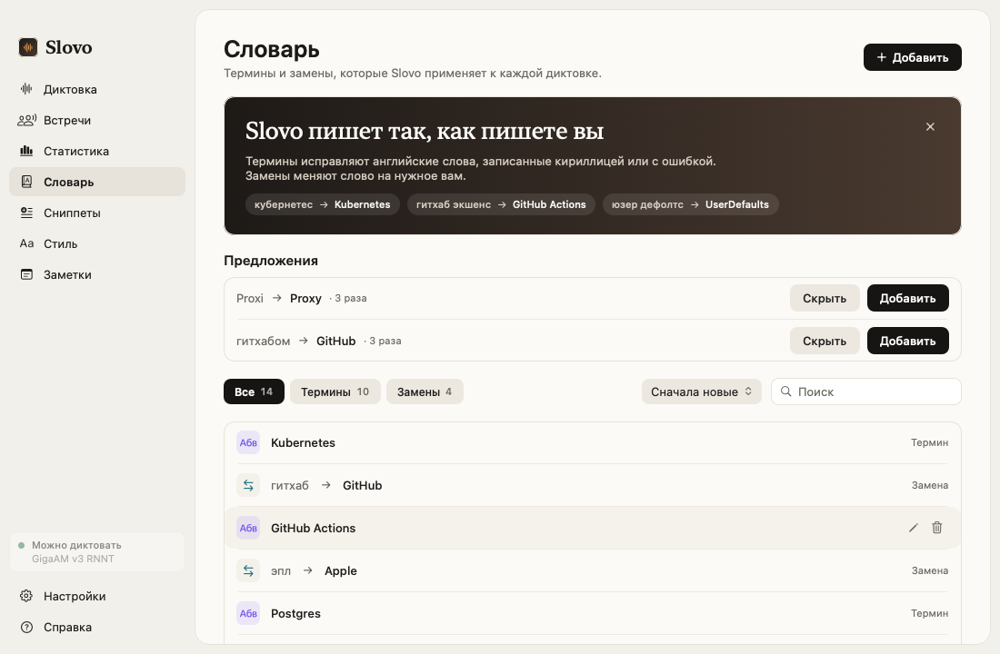
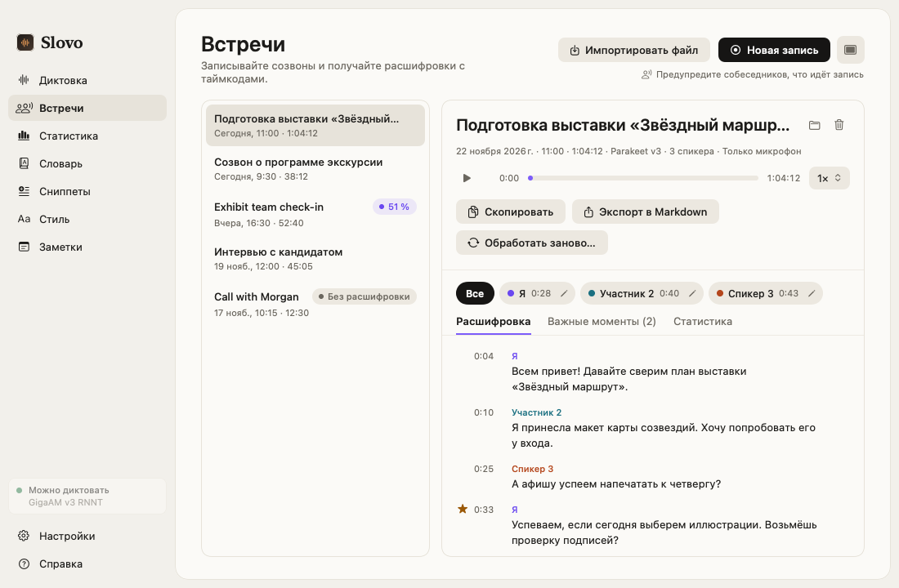

# Slovo

**Slovo — local push-to-talk dictation for macOS, Russian + English, no cloud.** On an Apple Silicon Mac with macOS 14.4 or later, get the DMG from [GitHub Releases](https://github.com/evgeniyov/Slovo/releases), drag Slovo to Applications, and follow setup to grant permissions and download a speech model. Hold Fn, speak, then release to paste the text at the cursor.

## Что такое Slovo

Slovo превращает речь в текст прямо на компьютере. Удерживайте клавишу диктовки, говорите по-русски или по-английски и отпускайте клавишу. Текст появится в активном поле. Slovo также записывает встречи и созвоны, разделяет расшифровку по спикерам и экспортирует её в Markdown.

### Скриншоты

| Главный экран | Словарь |
|---|---|
|  |  |

| Встречи | Настройки распознавания |
|---|---|
|  |  |


## Скачать и начать

Установщики и контрольные суммы доступны в [GitHub Releases](https://github.com/evgeniyov/Slovo/releases).

- **macOS** (Apple Silicon, 14.4 и новее). Откройте `Slovo-<версия>-macos-arm64.dmg` и перетащите Slovo в «Программы». Сборка использует ad-hoc подпись и выпускается без нотаризации Apple. Если macOS блокирует первый запуск, проверьте, доступна ли кнопка «Всё равно открыть» в разделе «Системные настройки → Конфиденциальность и безопасность». [Инструкция Apple](https://support.apple.com/en-us/102445).
- **Windows** (x64, Windows 10 2004+ или Windows 11). Запустите `Slovo-<версия>-win-x64-setup.exe` для установки текущему пользователю или распакуйте весь `Slovo-<версия>-win-x64-portable.zip` и запустите `Start Slovo.cmd`. В переносной версии данные хранятся в папке `Data` рядом с приложением.

При первом запуске на Mac настройте клавишу, скачайте модель и выдайте разрешения. Микрофон нужен для записи, мониторинг ввода — для глобальной клавиши, универсальный доступ — для вставки. Если вставка недоступна, Slovo копирует текст в буфер обмена. По умолчанию используется Fn (🌐). Если macOS сама реагирует на Fn, отключите это действие в настройках клавиатуры или выберите другую клавишу в Slovo. Для записи экрана и звука собеседников macOS запрашивает отдельные разрешения.

## Возможности macOS

- **Диктовка с клавишей или без удержания.** Панель показывает, когда Slovo слушает, распознаёт или копирует текст.
- **Русская, английская и смешанная речь.** Можно выбрать движки для диктовки и встреч. Для русской фразы с английскими терминами есть быстрый режим с помощником и точный режим с Whisper.
- **Словарь, сниппеты и обработка текста.** Slovo предлагает добавить замену, если находит в истории повторяющееся искажение термина. Словарь может исправить «кибернетес» на Kubernetes, а сниппет разворачивает короткую фразу в готовый текст. Есть очистка слов-паразитов и повторов.
- **История и заметки.** Можно искать диктовки, прослушивать записи, распознавать их другим движком и диктовать прямо в заметку.
- **Встречи.** Slovo записывает микрофон, системный звук и по желанию экран. В расшифровке есть таймкоды, спикеры и важные моменты. Разделение по спикерам требует macOS 15 или новее.
- **Входящие.** Аудио из папки «Входящие» и записи с Android можно импортировать и расшифровать как встречу.
- **Интеграция с Claude.** Через локальный MCP Claude может читать встречи и с отдельного разрешения добавлять итоги, решения и задачи.
- Интерфейс доступен на русском и английском.

## Как это работает

В режиме GigaAM Slovo начинает распознавать готовые фрагменты длиной до 20 секунд прямо во время записи. После отпускания клавиши движок заканчивает обработку, а Slovo применяет словарь, сниппеты и правила оформления и вставляет текст.

В быстром русско-английском режиме, если GigaAM вернул слова, похожие на искажённый английский, Slovo даёт прослушать запись помощнику. Режим «Авто» выбирает скачанный Whisper large-v3 turbo или Parakeet v3. Из ответа помощника Slovo берёт только подходящие английские слова. На ответ отводится `max(3 с, половина длительности записи)`. При ошибке или тайм-ауте используется текст GigaAM. В точном смешанном режиме Whisper распознаёт всю фразу с подсказкой из терминов словаря.

Для встреч Slovo сохраняет микрофон и системный звук на отдельных дорожках. После записи модель выделяет реплики спикеров, выбранный движок распознаёт их, а результат можно просмотреть в карточке встречи и экспортировать в Markdown.

### Модели

| Модель | Где используется | Лицензия |
|---|---|---|
| [GigaAM v3 RNNT и CTC](https://github.com/salute-developers/GigaAM) (Сбер) | Русская и смешанная речь, sherpa-onnx и ONNX Runtime | MIT |
| [Parakeet TDT 0.6B v3](https://huggingface.co/nvidia/parakeet-tdt-0.6b-v3) (NVIDIA) | Английская речь и помощник, на Mac через FluidAudio и Core ML | CC BY 4.0 |
| [Whisper large-v3 turbo](https://github.com/openai/whisper) (OpenAI) | Точная смешанная диктовка и помощник, через [whisper.cpp](https://github.com/ggml-org/whisper.cpp) и Metal | MIT |
| [pyannote community-1](https://huggingface.co/pyannote/speaker-diarization-community-1) (pyannoteAI) | Разделение по спикерам, Core ML-версия FluidInference | CC BY 4.0 |
| Apple Dictation | Системный движок в macOS 26 и новее | Условия Apple |

## Приватность

Распознавание выполняется на устройстве. Slovo работает без аккаунта и телеметрии. Интернет нужен для загрузки моделей. Записи, история и встречи на Mac хранятся в `~/Library/Application Support/Slovo/`. В Windows установленное приложение использует `%LOCALAPPDATA%\Slovo`.

Доступ MCP к встречам по умолчанию выключен. Если вы его включите, клиент Claude запускает Slovo локально и может получить разрешённые данные. Запись итогов включается отдельно.

## Сборка из исходников

### macOS

Нужны Mac с Apple Silicon, Python 3 и Xcode 26. GitHub Actions использует Xcode 26.3. Собранное приложение запускается на macOS 14.4 и новее.

```bash
git clone https://github.com/evgeniyov/Slovo.git
cd Slovo
xcodebuild -version
swift package resolve
python3 Scripts/repair_onnxruntime_framework.py
python3 build.py --dmg --sign-identity -
open Slovo.app
```

Проверьте, что `xcodebuild -version` показывает выбранную версию Xcode 26. SwiftPM скачивает и распаковывает ONNX Runtime при разрешении зависимостей. Скрипт восстанавливает ссылки внутри framework и должен идти после `swift package resolve` и перед `swift test`. Повторите эти два шага после сброса пакетов. Без `--dmg` скрипт сборки создаёт только `Slovo.app`.

### Windows

Нужен .NET 10 SDK. Для упаковки установите Python 3 и добавьте компилятор NSIS (`makensis`) в `PATH`. Выполните команды в PowerShell из корня репозитория.

```powershell
dotnet publish Windows/src/Slovo.App -c Release -r win-x64 --self-contained -p:Version=0.5.1 -o dist/Slovo-win-x64
python Windows/package/build_release.py dist/Slovo-win-x64 --version 0.5.1 --output dist/release
```

Версия Windows поддерживает диктовку и запись встреч. Разработка на паузе, помощник для английских слов пока доступен на Mac. Подробнее в [документации Windows](docs/WINDOWS.md).

### Android

Телефонное приложение «Входящие» записывает аудио для переноса на компьютер. Нужны JDK 17 и Android SDK 35. Для запуска APK нужен Android 10 или новее.

```bash
cd Android
./gradlew assembleDebug
```

Готовый APK находится в `Android/app/build/outputs/apk/debug/app-debug.apk` относительно корня репозитория.

## Тесты

Запустите тесты из корня репозитория.

```bash
# macOS, после выбора Xcode
swift package resolve
python3 Scripts/repair_onnxruntime_framework.py
swift test

# Windows с .NET 10 SDK
dotnet test Windows/Slovo.slnx -c Release
```

Дополнительные тесты на Mac используют уже скачанные модели.

| Переменная | Значение |
|---|---|
| `SLOVO_WHISPER_MODEL` | Путь к файлу `ggml-large-v3-turbo-q5_0.bin` для тестов Whisper |
| `SLOVO_DIARIZATION_MODELS` | Путь к папке модели разделения по спикерам |
| `SLOVO_NETWORK_TESTS=1` | Включает сетевой тест загрузки Whisper вместе с `SLOVO_WHISPER_MODEL` |

Для тестов .NET `SLOVO_MODELS_DIR` задаёт путь к папке моделей распознавания. `SLOVO_DIARIZATION_MODELS_DIR` указывает на скачанную папку `diarization-onnx` для тестов разделения по спикерам.

CI запускает тесты macOS и Windows при пуше в `main` и для pull request. Теги вида `v0.5.1` запускают сборку установщиков на GitHub Actions.

## Лицензия

Slovo распространяется по лицензии [MIT](LICENSE). Лицензии и авторство сторонних компонентов перечислены в [THIRD-PARTY-NOTICES.md](THIRD-PARTY-NOTICES.md).
